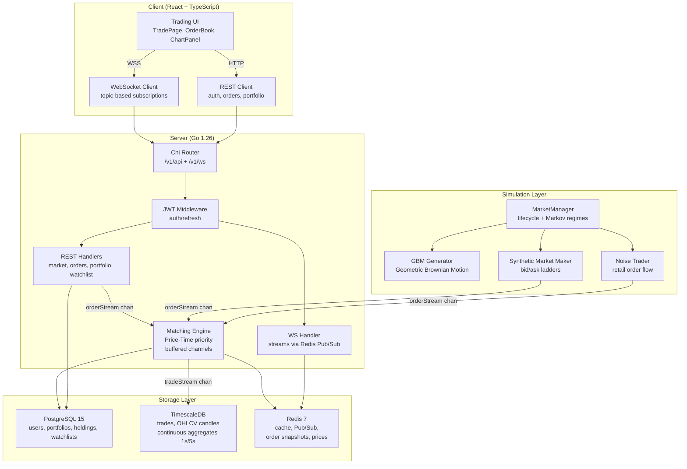
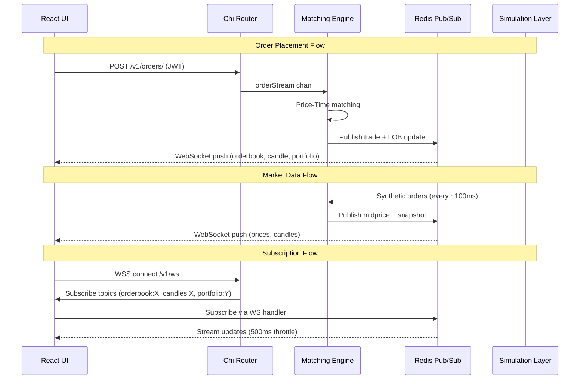

# Algorithmic Trading Simulator

A full-stack, real-time paper-trading platform featuring an in-memory simulated stock exchange, concurrent matching engine, synthetic market making, noise trader simulation, and a professional, responsive React trading UI.


---

## 1. Overview

The **Algorithmic Trading Simulator** simulates an entire stock exchange **in-memory** using Go, providing a realistic paper-trading environment. It features:
*   **Concurrent Matching Engine**: Built on Go channels running with Price-Time priority.
*   **Synthetic Market Maker**: Emits real-time bid/ask ladders with power-law quantity scaling and dynamic spread adjustment.
*   **Noise Trader Simulation**: Simulates retail order flow using heavy-tailed Pareto distributions, EMA momentum bias, and U-shaped intraday volume.
*   **GBM Price Generation**: Simulates market trends via Geometric Brownian Motion price streams with Markov-regime transitions.
*   **Real-time Streaming**: Uses Redis Pub/Sub to deliver WebSocket updates to the client under 500ms throttles.
*   **Professional UI**: React dashboard containing Trade page, Order Book, Charts (Lightweight Charts), Portfolio breakdowns, and Analytics indicators.

The platform configures and simulates **15 Indian stock market assets** across various segments (Large, Mid, Small, Micro, PSU, FMCG, Tech).

---

## 2. System Architecture



---

## 3. Core Data Flows

### Order Placement & Execution Flow


---

## 4. Technology Stack

### Backend
*   **Go 1.26**: Language for high-performance matching and concurrency.
*   **Chi (`go-chi/chi/v5`)**: Lightweight, idiomatic router for building REST APIs.
*   **`coder/websocket`**: High-performance WebSocket library.
*   **GORM**: ORM for schema migration and database queries.
*   **JWT (`golang-jwt/jwt/v5`)**: Authentication mechanism via short-lived Access tokens and longer-lived Refresh tokens.
*   **Bcrypt**: Secure password hashing.
*   **Viper**: Config management via YAML and environment overrides.

### Frontend (Client)
*   **React 18**: Frontend UI framework.
*   **TypeScript**: Static type-safety.
*   **Vite**: Fast bundling and HMR development server.
*   **Tailwind CSS v3**: Utility-first CSS framework.
*   **Lightweight Charts**: Fast, interactive financial chart renderer.
*   **`react-resizable-panels`**: Flexible Multi-panel panel layouts.

### Infrastructure & Storage
*   **PostgreSQL 15**: Primary database storing users, static assets, portfolios, holdings, and watchlists.
*   **TimescaleDB**: Time-series extension storing raw tick data, executed trades, and rolling candle aggregates.
*   **Redis 7**: Pub/Sub broker, fast caching, order status caching, and order book snapshots.
*   **Docker + Compose**: Orchestration of services.
*   **Nginx (Alpine)**: Serves static assets for the client.

---

## 5. Server Folder Structure

```text
server/
├── cmd/
│   └── synthetic-bull/
│       └── main.go                             # App Entry Point
├── internal/
│   ├── api/
│   │   ├── middleware/
│   │   │   └── jwt_middleware.go               # JWT Auth Middleware
│   │   └── router.go                           # Router Registrations
│   ├── config/
│   │   └── config.go                           # Configuration Manager
│   ├── database/
│   │   └── db.go                               # DB Connection (Primary & TSDB)
│   ├── handlers/
│   │   ├── auth.go                             # Register/Login handlers
│   │   ├── market.go                           # Assets & historical candle API
│   │   ├── orders.go                           # Order placing & cancelling REST
│   │   ├── portfolio.go                        # Balances, holdings & equity curve
│   │   ├── watchlist.go                        # Watchlist adjustments
│   │   └── ws.go                               # WebSocket client connections
│   ├── matching/
│   │   ├── engine.go                           # Matching Engine loop
│   │   ├── LOBBuilder.go                       # Shadow OrderBook aggregator
│   │   ├── orderqueue.go                       # Price level queue (linked list)
│   │   └── orderside.go                        # Order side BST structures
│   ├── models/
│   │   └── models.go                           # Shared GORM schemas
│   ├── simulation/
│   │   ├── gbm/
│   │   │   ├── generator.go                    # Geometric Brownian Motion ticks
│   │   │   ├── manager.go                      # Asset drift/volatility transition
│   │   │   └── profile.go                      # Market Markov regime settings
│   │   ├── noise/
│   │   │   ├── agent.go                        # Noise Trader agent logic
│   │   │   ├── direction.go                    # Trend-following vs Contrarian EMA
│   │   │   ├── timing.go                       # U-shaped intraday volume
│   │   │   └── volume.go                       # Pareto order size distribution
│   │   └── synthetic/
│   │       └── agent.go                        # Synthetic Market Maker ladders
│   ├── storage/
│   │   └── storage.go                          # DB repositories & Redis Client
│   └── utils/
│       └── response/
│           └── response.go                     # Standardized HTTP JSON payloads
```

---

## 6. System Component Design

### 6.1 Concurrent Matching Engine
The core matching engine is an **in-memory, concurrent** order executor running inside [engine.go](file:///d:/Fullstack/Algorithmic-Trading-Simulator/server/internal/matching/engine.go):
*   **Buffered Channel Architecture**: The Chi REST handlers write trade actions into a buffered Go channel (`orderStream`, capacity 100k) to prevent route blockage during high load.
*   **Single Goroutine Execution**: An engine loop consumes sequentially from `orderStream`, preventing race conditions and resource deadlocks without using mutexes.
*   **Data Structures**:
    *   [OrderSide](file:///d:/Fullstack/Algorithmic-Trading-Simulator/server/internal/matching/orderside.go): Represents a side of the book (bids or asks), maintaining sorting using a binary search tree-like structure.
    *   [OrderQueue](file:///d:/Fullstack/Algorithmic-Trading-Simulator/server/internal/matching/orderqueue.go): Doubly-linked list per price level achieving $O(1)$ insertions and deletions.
    *   `OrderIndex`: Hash map mapping order IDs to queue nodes for immediate $O(1)$ order cancellations.
*   **Self-Trade Prevention (STP)**: Order matching checks the matching parties' User IDs. If they match, the engine rejects the match to prevent self-wash trading.
*   **Shadow Book**: Implemented in [LOBBuilder.go](file:///d:/Fullstack/Algorithmic-Trading-Simulator/server/internal/matching/LOBBuilder.go). It consumes the trade event stream and publishes limit order book (LOB) snapshots to Redis Pub/Sub every 1s.

### 6.2 Simulation Layer
The simulation operates to populate the exchange with realistic tick pricing, order books, and liquid spreads.

#### GBM Price Generator
Located in [generator.go](file:///d:/Fullstack/Algorithmic-Trading-Simulator/server/internal/simulation/gbm/generator.go) and managed by [manager.go](file:///d:/Fullstack/Algorithmic-Trading-Simulator/server/internal/simulation/gbm/manager.go). It uses a standard Geometric Brownian Motion algorithm to simulate pricing:
$$dS_t = \mu S_t dt + \sigma S_t dW_t$$
Where:
*   $\mu$ is the drift coefficient.
*   $\sigma$ is the volatility coefficient.
*   $dW_t$ is the Wiener process (random normal distribution).

Parameters transition through **Markov-chain states** configured in [profile.go](file:///d:/Fullstack/Algorithmic-Trading-Simulator/server/internal/simulation/gbm/profile.go):
*   **Drift States**: Bear, Bull, Normal, Flat (updated every 5–30 minutes).
*   **Volatility States**: Panic, Elevated, Normal, Quiet (updated every 5–30 minutes).

#### Synthetic Market Maker
Implemented in [agent.go](file:///d:/Fullstack/Algorithmic-Trading-Simulator/server/internal/simulation/synthetic/agent.go). It maintains liquidity by placing bid/ask ladders:
*   Places up to 10 layers of bids and asks around the midprice every ~100ms tick.
*   **Vol spread scaling**: Widens the spread during volatile regimes (0.3x to 3.0x).
*   **Power-law quantity scaling**:
    $$Q = \text{baseConstant} \times P^{\text{scalingFactor}}$$
*   **Momentum Skewing**: Shifts bids and asks to create directional buying/selling pressure based on historical drifts.
*   Operates under a reserved synthetic user ID: `999999998`.

#### Noise Trader
Implemented in [agent.go](file:///d:/Fullstack/Algorithmic-Trading-Simulator/server/internal/simulation/noise/agent.go). It represents standard retail traders:
*   **Pareto-distributed sizes**: Simulates realistic distribution of small retail orders and rare block trades ($\alpha = 1.5$) via [volume.go](file:///d:/Fullstack/Algorithmic-Trading-Simulator/server/internal/simulation/noise/volume.go).
*   **EMA Momentum Bias**: Triggers trend-following behavior using an Exponential Moving Average (EMA) of historical prices, with a 15% contrarian probability to fade the trend, evaluated in [direction.go](file:///d:/Fullstack/Algorithmic-Trading-Simulator/server/internal/simulation/noise/direction.go).
*   **U-shaped Intraday Volume**: Volume spikes at market open and close, while slowing down in the middle of the simulated session, managed by [timing.go](file:///d:/Fullstack/Algorithmic-Trading-Simulator/server/internal/simulation/noise/timing.go).
*   Operates with randomized user IDs in the range `900000000` to `909999999`.

---

## 7. Simulated Assets

The simulator configures 15 Indian stock market assets with realistic starting prices:

| Symbol | Market Cap Segment / Class | Start Price (INR) |
| :--- | :--- | :--- |
| **RELIANCE** | Large Cap Bluechip | 2,950.00 |
| **HDFCBANK** | Private Sector Financial | 1,530.00 |
| **ICICIBANK** | Private Sector Financial | 1,080.00 |
| **TCS** | IT Services | 3,980.00 |
| **INFY** | IT Services | 1,490.00 |
| **ITC** | Defensive FMCG | 430.00 |
| **HINDUNILVR** | Defensive FMCG | 2,250.00 |
| **SBIN** | PSU Banking | 760.00 |
| **COALINDIA** | PSU Energy | 440.00 |
| **LT** | Cyclical Infrastructure | 3,750.00 |
| **SUNPHARMA** | Healthcare / Pharma | 1,620.00 |
| **TATAELXSI** | Mid Cap Growth | 7,800.00 |
| **CDSL** | Small Cap Exchange Service | 1,950.00 |
| **SUZLON** | Micro Cap / Penny Stock | 42.50 |
| **IDEA** | Micro Cap / Penny Stock | 13.80 |

---

## 8. Real-Time Data Pipeline

All WebSocket traffic is distributed using a multiplexed **Redis Pub/Sub** network, ensuring horizontal scalability:

| Redis Channel Name | Event Payload | Frequency / Throttle |
| :--- | :--- | :--- |
| `candles:{symbol}` | Historical OHLCV candle updates | Real-time on execution |
| `orderbook:{symbol}` | Aggregated LOB bids and asks lists | Throttled to 1,000ms |
| `midprice:{symbol}` | Tick midprice float | Event-driven (on GBM/MM ticks) |
| `prices:all` | Tick summary of all assets | Throttled to 500ms |
| `trades:{symbol}` | Executed trade records ring buffer | Event-driven |

The server's WebSocket handler [ws.go](file:///d:/Fullstack/Algorithmic-Trading-Simulator/server/internal/handlers/ws.go) subscribes to these channels and publishes them to connected clients.

---

## 9. API Reference

All routes are prefixed with `/v1`. JWT endpoints require an `Authorization: Bearer <Access_Token>` header.

| Method | Route Path | Auth Required | Functionality | Handler |
| :--- | :--- | :--- | :--- | :--- |
| **POST** | `/auth/register` | No | Creates a new user profile and returns JWT tokens | [auth.go](file:///d:/Fullstack/Algorithmic-Trading-Simulator/server/internal/handlers/auth.go) |
| **POST** | `/auth/login` | No | Authenticates user credentials | [auth.go](file:///d:/Fullstack/Algorithmic-Trading-Simulator/server/internal/handlers/auth.go) |
| **POST** | `/auth/refresh` | No | Uses Refresh Token to acquire new Access Token | [auth.go](file:///d:/Fullstack/Algorithmic-Trading-Simulator/server/internal/handlers/auth.go) |
| **POST** | `/auth/logout` | No | Revokes active user session | [auth.go](file:///d:/Fullstack/Algorithmic-Trading-Simulator/server/internal/handlers/auth.go) |
| **GET** | `/ws` | Optional | Upgrades connection to WebSockets | [ws.go](file:///d:/Fullstack/Algorithmic-Trading-Simulator/server/internal/handlers/ws.go) |
| **GET** | `/assets` | No | Lists tradeable assets and segment parameters | [market.go](file:///d:/Fullstack/Algorithmic-Trading-Simulator/server/internal/handlers/market.go) |
| **GET** | `/marketdata/{symbol}` | No | Returns last price, volume, change percentage | [market.go](file:///d:/Fullstack/Algorithmic-Trading-Simulator/server/internal/handlers/market.go) |
| **GET** | `/candles/{symbol}/{interval}`| No | Returns historical OHLCV candles | [market.go](file:///d:/Fullstack/Algorithmic-Trading-Simulator/server/internal/handlers/market.go) |
| **POST** | `/orders/` | **Yes (JWT)** | Places a limit/market buy or sell order | [orders.go](file:///d:/Fullstack/Algorithmic-Trading-Simulator/server/internal/handlers/orders.go) |
| **DELETE** | `/orders/{id}` | **Yes (JWT)** | Cancels an active limit order | [orders.go](file:///d:/Fullstack/Algorithmic-Trading-Simulator/server/internal/handlers/orders.go) |
| **GET** | `/orders/{id}` | **Yes (JWT)** | Queries the current status of an order | [orders.go](file:///d:/Fullstack/Algorithmic-Trading-Simulator/server/internal/handlers/orders.go) |
| **GET** | `/orders/active` | **Yes (JWT)** | Fetches all active, unfilled orders | [orders.go](file:///d:/Fullstack/Algorithmic-Trading-Simulator/server/internal/handlers/orders.go) |
| **GET** | `/orders/history` | **Yes (JWT)** | Fetches paginated list of all past orders | [orders.go](file:///d:/Fullstack/Algorithmic-Trading-Simulator/server/internal/handlers/orders.go) |
| **GET** | `/trades/history` | **Yes (JWT)** | Fetches paginated executed trades | [orders.go](file:///d:/Fullstack/Algorithmic-Trading-Simulator/server/internal/handlers/orders.go) |
| **GET** | `/portfolio/history` | **Yes (JWT)** | Returns buying power, positions, equity curve | [portfolio.go](file:///d:/Fullstack/Algorithmic-Trading-Simulator/server/internal/handlers/portfolio.go) |
| **POST** | `/portfolio/reset` | **Yes (JWT)** | Resets paper-trading profile (buying power to 10L) | [portfolio.go](file:///d:/Fullstack/Algorithmic-Trading-Simulator/server/internal/handlers/portfolio.go) |
| **GET** | `/watchlist/` | **Yes (JWT)** | Fetches watchlisted assets | [watchlist.go](file:///d:/Fullstack/Algorithmic-Trading-Simulator/server/internal/handlers/watchlist.go) |
| **POST** | `/watchlist/{symbol}` | **Yes (JWT)** | Adds asset to watchlist | [watchlist.go](file:///d:/Fullstack/Algorithmic-Trading-Simulator/server/internal/handlers/watchlist.go) |
| **DELETE** | `/watchlist/{symbol}` | **Yes (JWT)** | Removes asset from watchlist | [watchlist.go](file:///d:/Fullstack/Algorithmic-Trading-Simulator/server/internal/handlers/watchlist.go) |

---

## 10. Client (React) Architecture

The frontend client configures a stateful layout with full router integration inside [App.tsx](file:///d:/Fullstack/Algorithmic-Trading-Simulator/Client/src/App.tsx).

### Navigation & Layout
*   **Layout Component**: Includes a collateral resizable layout utilizing `react-resizable-panels` that supports multi-pane splits.
*   **Theme Integration**: Supports a fully customized dark mode system with tailwind classes in [index.css](file:///d:/Fullstack/Algorithmic-Trading-Simulator/Client/src/index.css).

### Pages
*   [LandingPage.tsx](file:///d:/Fullstack/Algorithmic-Trading-Simulator/Client/src/components/pages/LandingPage.tsx): Splash screen introducing paper-trading parameters.
*   [LoginPage.tsx](file:///d:/Fullstack/Algorithmic-Trading-Simulator/Client/src/components/pages/LoginPage.tsx) / [SignUpPage.tsx](file:///d:/Fullstack/Algorithmic-Trading-Simulator/Client/src/components/pages/SignUpPage.tsx): Authentication screens.
*   [TradePage.tsx](file:///d:/Fullstack/Algorithmic-Trading-Simulator/Client/src/components/pages/TradePage.tsx): Central trading desk mounting four panels.
*   [MarketsPage.tsx](file:///d:/Fullstack/Algorithmic-Trading-Simulator/Client/src/components/pages/MarketsPage.tsx): Grid showing sparkline-like movements and asset lists.
*   [WatchlistPage.tsx](file:///d:/Fullstack/Algorithmic-Trading-Simulator/Client/src/components/pages/WatchlistPage.tsx): Customized list of followed tickers.
*   [PortfolioPage.tsx](file:///d:/Fullstack/Algorithmic-Trading-Simulator/Client/src/components/pages/PortfolioPage.tsx): Visualizes buying power, holdings, and asset allocation weights.
*   [AnalyticsPage.tsx](file:///d:/Fullstack/Algorithmic-Trading-Simulator/Client/src/components/pages/AnalyticsPage.tsx): Performance breakdown showing win ratios, profit factors, and equity charts.
*   [HistoryPage.tsx](file:///d:/Fullstack/Algorithmic-Trading-Simulator/Client/src/components/pages/HistoryPage.tsx): Logs of past orders and trade executions.

### Workspace Panels
*   [OrderBook.tsx](file:///d:/Fullstack/Algorithmic-Trading-Simulator/Client/src/components/panels/OrderBook.tsx): Displays real-time bid/ask lists and volume depths.
*   [ChartPanel.tsx](file:///d:/Fullstack/Algorithmic-Trading-Simulator/Client/src/components/panels/ChartPanel.tsx): Incorporates TradingView's Lightweight Charts for canvas candle plots.
*   [OrderForm.tsx](file:///d:/Fullstack/Algorithmic-Trading-Simulator/Client/src/components/panels/OrderForm.tsx): Submit market or limit actions with computed balance bounds.
*   [Balances.tsx](file:///d:/Fullstack/Algorithmic-Trading-Simulator/Client/src/components/panels/Balances.tsx): Inline visual of current holding weights.

### WebSocket React Hooks
*   [useMarketPrices.ts](file:///d:/Fullstack/Algorithmic-Trading-Simulator/Client/src/hooks/useMarketPrices.ts): Receives consolidated prices.
*   [useOrderBook.ts](file:///d:/Fullstack/Algorithmic-Trading-Simulator/Client/src/hooks/useOrderBook.ts): Connects to live OrderBook snapshots.
*   [usePortfolio.ts](file:///d:/Fullstack/Algorithmic-Trading-Simulator/Client/src/hooks/usePortfolio.ts): Updates balances instantly on execution triggers.
*   [useTrade.ts](file:///d:/Fullstack/Algorithmic-Trading-Simulator/Client/src/hooks/useTrade.ts): Listens to live candlestick updates.
*   [useWatchlistData.ts](file:///d:/Fullstack/Algorithmic-Trading-Simulator/Client/src/hooks/useWatchlistData.ts): Manages Watchlist sync.
*   [useAuth.ts](file:///d:/Fullstack/Algorithmic-Trading-Simulator/Client/src/hooks/useAuth.ts): Manages active token sessions.

---

## 11. Git Workflow Guidelines

Always coordinate development on the `develop` branch. **Do not push directly to `main`**.

### 1. Sync with `develop`
Before coding, pull the latest changes:
```bash
git checkout develop
git pull origin develop
```

### 2. Create a Feature Branch
Create your branch with a descriptive prefix:
```bash
git checkout -b feat/your-feature-name
```

### 3. Commit Changes
Use semantic committing conventions:
```bash
git add .
git commit -m "feat: description of the feature"
```

### 4. Push Feature Branch
```bash
git push -u origin feat/your-feature-name
```

### 5. Open Pull Request (PR)
Create a Pull Request on GitHub matching these branch rules:
*   **base**: `develop`
*   **compare**: `feat/your-feature-name`
*   Review differences and resolve merge conflicts prior to final verification.

### 6. Merge & Sync
Once conflicts are resolved and senior team checks pass, the PR is merged into `develop`.

---

## 12. Local Setup & Execution

Ensure you have **Node.js**, **Go 1.26**, and **Docker** installed.

### Backend Setup (Go Server)
1.  Navigate into the server folder:
    ```bash
    cd server
    ```
2.  Initialize the dependencies:
    ```bash
    go mod tidy
    ```
3.  Boot database dependencies via Docker Compose:
    ```bash
    docker compose up -d
    ```
4.  Run the application server:
    ```bash
    go run cmd/synthetic-bull/main.go
    ```
    The server will startup at: `http://localhost:8080`
5.  Ping verification:
    ```bash
    curl http://localhost:8080/ping
    curl http://localhost:8080/health
    ```

### Client Setup (React)
1.  Navigate to the Client workspace:
    ```bash
    cd Client
    ```
2.  Install dependencies:
    ```bash
    npm install
    ```
3.  Start the local developer server:
    ```bash
    npm run dev
    ```
    The local browser workspace will load at `http://localhost:5173`.

---

## 13. One-Click Docker Execution

The entire environment (Server, Client, PostgreSQL, TimescaleDB, and Redis) can run as a multi-stage docker stack.

### Step 1: Create Environment Variables
Create a file named `.env` in the project root directory and add the database passwords and JWT secrets:
```env
PRIMARY_DB_PASSWORD=local_secret_db
CANDLESTICK_DB_PASSWORD=local_secret_ts
REDIS_PASSWORD=local_secret_redis
SERVER_JWT_SECRET=local_super_secret_jwt_key
SERVER_JWT_REFRESH_SECRET=local_super_secret_refresh_key
```

### Step 2: Build & Start Containers
From the project root folder, boot the stack using the [docker-compose.yml](file:///d:/Fullstack/Algorithmic-Trading-Simulator/docker-compose.yml):
```bash
docker compose up -d --build
```

### Step 3: Access Frontend
Once built, access the running production-like application client at:
*   `http://localhost` (or `http://localhost:80`)

The Docker network routes these internal ports:

| Service / Container | External Port | Internal Port | Base Image |
| :--- | :--- | :--- | :--- |
| **`ats_frontend`** (Client) | `80` | `80` | `nginx:alpine` |
| **`ats_backend`** (Server) | `8080` | `8080` | `golang:1.26-alpine` |
| **`ats_primary_db`** (Postgres) | `5432` | `5432` | `postgres:15` |
| **`ats_candlestick_db`** (Timescale) | `5433` | `5432` | `timescale/timescaledb:latest` |
| **`ats_redis`** (Redis) | `6379` | `6379` | `redis:7` |
