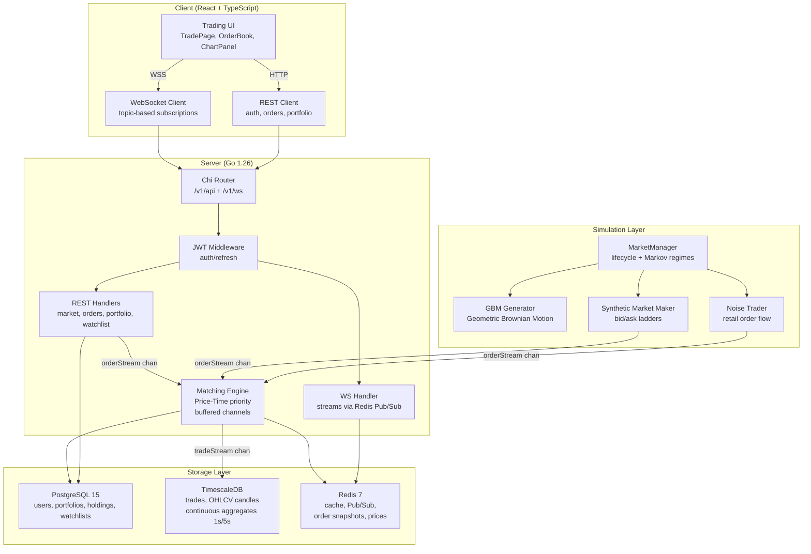
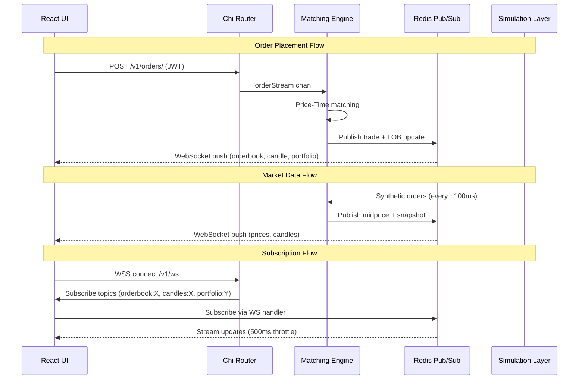
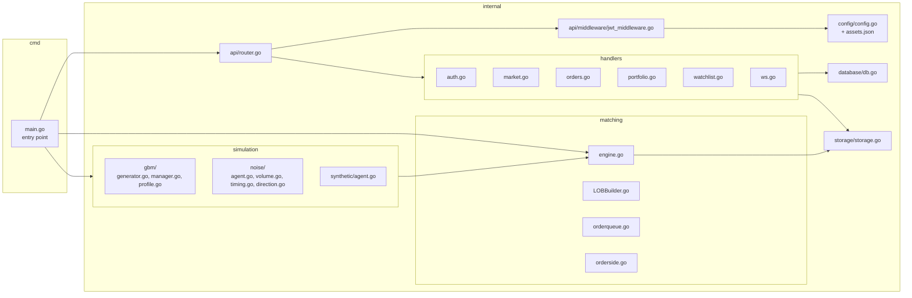

# Algorithmic Trading Simulator - Detailed Project Documentation

A full-stack paper-trading platform with a simulated stock exchange, real-time market data, and professional trading UI.

---

## 1. Overview

The **Algorithmic Trading Simulator** simulates an entire stock exchange **in-memory** using Go, providing a realistic paper-trading environment. It features a concurrent matching engine with Price-Time priority, synthetic market making, noise trader simulation, Geometric Brownian Motion price generation, and real-time WebSocket streaming — all wrapped in a professional React-based trading UI.

The system simulates **15 Indian stock market assets** across 10 market cap segments (Large Cap, Mid Cap, Small Cap, Micro Cap/Penny, PSU, etc.) with realistic drift/volatility regime switching.

---

## 2. System Architecture

---

## 3. Data Flow

---

## 4. Tech Stack

### Backend (Go)
| Technology | Purpose |
| :--- | :--- |
| Go 1.26 | Core language; concurrent, channel-based architecture |
| Chi (`go-chi/chi/v5`) | HTTP router with middleware chaining |
| `coder/websocket` | WebSocket library |
| GORM | ORM for PostgreSQL / TimescaleDB |
| `golang-jwt/jwt/v5` | JWT access + refresh token authentication |
| `bcrypt` | Password hashing |
| Viper (`spf13/viper`) | YAML + env configuration |
| `go-playground/validator` | Request payload validation |

### Frontend (Client)
| Technology | Purpose |
| :--- | :--- |
| React 18 | UI framework |
| TypeScript | Type safety |
| Vite | Build tool and dev server |
| React Router DOM v7 | Client-side routing |
| Tailwind CSS v3 | Utility-first styling |
| Lightweight Charts | TradingView-style charting |
| Lucide React | Icons |
| `react-resizable-panels` | Resizable panel layouts |

### Infrastructure
| Technology | Purpose |
| :--- | :--- |
| PostgreSQL 15 | Primary database (users, portfolios, watchlists) |
| TimescaleDB | Time-series database (trades, OHLCV candles) |
| Redis 7 | Caching, Pub/Sub, real-time data distribution |
| Docker + Compose | Multi-service orchestration |
| Nginx (Alpine) | Serves built frontend in production |

---

## 5. Server Architecture

---

## 6. Matching Engine Design

The core matching engine is an **in-memory, concurrent** system built on Go channels:

*   **Buffered Channels** – `orderStream` (100k buffer) decouples REST handlers from the matching goroutine.
*   **Deterministic Execution** – A single background goroutine processes orders sequentially in [engine.go](file:///d:/Fullstack/Algorithmic-Trading-Simulator/server/internal/matching/engine.go), guaranteeing Price-Time priority without mutex locks.
*   **Self-Trade Prevention (STP)** – Blocks trades where both buying and selling parties share the same `UserID`.
*   **Order Book Data Structures**:
    *   [OrderSide](file:///d:/Fullstack/Algorithmic-Trading-Simulator/server/internal/matching/orderside.go) – Keeps price levels sorted using a balanced binary tree or sorted slice.
    *   [OrderQueue](file:///d:/Fullstack/Algorithmic-Trading-Simulator/server/internal/matching/orderqueue.go) – Doubly-linked list per price level to achieve $O(1)$ push, pop, and remove operations.
    *   `OrderIndex` – Hash map from order ID to queue node pointer for $O(1)$ cancel operations.
*   [LOBBuilder](file:///d:/Fullstack/Algorithmic-Trading-Simulator/server/internal/matching/LOBBuilder.go) (**Shadow Book**) – Maintains a real-time shadow book using the event stream and publishes limit order book (LOB) snapshots every 1s via Redis Pub/Sub.
*   **Supported Order Types** – Limit, Market, and Cancel orders.

---

## 7. Simulation Layer

### 7.1 GBM Price Generator
The Geometric Brownian Motion generator in [generator.go](file:///d:/Fullstack/Algorithmic-Trading-Simulator/server/internal/simulation/gbm/generator.go) runs with a tick resolution of ~100ms.
Each asset has independent drift and volatility parameters managed by [manager.go](file:///d:/Fullstack/Algorithmic-Trading-Simulator/server/internal/simulation/gbm/manager.go) that transition through **Markov states** configured in [profile.go](file:///d:/Fullstack/Algorithmic-Trading-Simulator/server/internal/simulation/gbm/profile.go):

| Parameter | States | Transition Interval |
| :--- | :--- | :--- |
| **Drift** | Bear \| Bull \| Normal \| Flat | Every 5–30 minutes |
| **Volatility** | Panic \| Elevated \| Normal \| Quiet | Every 5–30 minutes |

### 7.2 Synthetic Market Maker
Implemented in [agent.go](file:///d:/Fullstack/Algorithmic-Trading-Simulator/server/internal/simulation/synthetic/agent.go):
*   Places **bid/ask ladders** every ~100ms tick.
*   Applies dynamic spread scaling based on volatility (0.3x to 3.0x).
*   **Power-law notional scaling**: $Q = \text{baseConstant} \times P^{\text{scalingFactor}}$
*   **Volatility thinning** – reduces available quantity when volatility spikes.
*   **Drift skewing** – skews bid/ask quantities based on market trend/momentum.
*   Operates under a reserved synthetic user ID: `999999998`.

### 7.3 Noise Trader
Implemented in [agent.go](file:///d:/Fullstack/Algorithmic-Trading-Simulator/server/internal/simulation/noise/agent.go):
*   Simulates realistic retail order flow and noise trading behavior.
*   Uses a **Pareto distribution** for order sizes (heavy-tailed, $\alpha = 1.5$) via [volume.go](file:///d:/Fullstack/Algorithmic-Trading-Simulator/server/internal/simulation/noise/volume.go).
*   Applies a **momentum bias** using an Exponential Moving Average (EMA) of prices in [direction.go](file:///d:/Fullstack/Algorithmic-Trading-Simulator/server/internal/simulation/noise/direction.go).
*   **Contrarian behavior** – has a 15% probability of fading the current trend.
*   **U-shaped intraday volume distribution** – high volume at market open/close, lower volume around midday, managed by [timing.go](file:///d:/Fullstack/Algorithmic-Trading-Simulator/server/internal/simulation/noise/timing.go).
*   Mix: 70% market orders, 30% limit orders.
*   Uses randomized client user IDs in the range `900000000` to `909999999`.

---

## 8. Simulated Assets

The simulation configures 15 Indian stock market assets:

| Symbol | Class / Market Cap Segment | Start Price (INR) |
| :--- | :--- | :--- |
| **RELIANCE** | Large Cap Bluechip | 2,950.00 |
| **HDFCBANK** | Private Sector Financial | 1,530.00 |
| **ICICIBANK** | Private Sector Financial | 1,080.00 |
| **TCS** | IT Services | 3,980.00 |
| **INFY** | IT Services | 1,490.00 |
| **ITC** | Defensive FMCG | 430.00 |
| **HINDUNILVR** | Defensive FMCG | 2,250.00 |
| **SBIN** | PSU Banking | 760.00 |
| **COALINDIA** | PSU Equity | 440.00 |
| **LT** | Cyclical Infrastructure | 3,750.00 |
| **SUNPHARMA** | Healthcare / Pharma | 1,620.00 |
| **TATAELXSI** | Mid Cap Growth | 7,800.00 |
| **CDSL** | Small Cap Exchange/Service | 1,950.00 |
| **SUZLON** | Micro Cap / Penny Stock | 42.50 |
| **IDEA** | Micro Cap / Penny Stock | 13.80 |

---

## 9. API Reference

Base Path: `/v1`

| Method | Path | Auth Required | Description | Handler File |
| :--- | :--- | :--- | :--- | :--- |
| **POST** | `/auth/register` | No | Create user account & issue token pair | [auth.go](file:///d:/Fullstack/Algorithmic-Trading-Simulator/server/internal/handlers/auth.go) |
| **POST** | `/auth/login` | No | Authenticate & issue token pair | [auth.go](file:///d:/Fullstack/Algorithmic-Trading-Simulator/server/internal/handlers/auth.go) |
| **POST** | `/auth/refresh` | No | Rotate access token | [auth.go](file:///d:/Fullstack/Algorithmic-Trading-Simulator/server/internal/handlers/auth.go) |
| **POST** | `/auth/logout` | No | Revoke session | [auth.go](file:///d:/Fullstack/Algorithmic-Trading-Simulator/server/internal/handlers/auth.go) |
| **GET** | `/ws` | Optional | WebSocket connection upgrade | [ws.go](file:///d:/Fullstack/Algorithmic-Trading-Simulator/server/internal/handlers/ws.go) |
| **GET** | `/assets` | No | List all tradeable assets | [market.go](file:///d:/Fullstack/Algorithmic-Trading-Simulator/server/internal/handlers/market.go) |
| **GET** | `/marketdata/{symbol}` | No | Fetch latest price, volume, change | [market.go](file:///d:/Fullstack/Algorithmic-Trading-Simulator/server/internal/handlers/market.go) |
| **GET** | `/candles/{symbol}/{interval}` | No | Fetch historical OHLCV candle data | [market.go](file:///d:/Fullstack/Algorithmic-Trading-Simulator/server/internal/handlers/market.go) |
| **POST** | `/orders/` | **Yes (JWT)** | Place a new limit or market order | [orders.go](file:///d:/Fullstack/Algorithmic-Trading-Simulator/server/internal/handlers/orders.go) |
| **DELETE** | `/orders/{id}` | **Yes (JWT)** | Cancel an active order | [orders.go](file:///d:/Fullstack/Algorithmic-Trading-Simulator/server/internal/handlers/orders.go) |
| **GET** | `/orders/{id}` | **Yes (JWT)** | Query status of a single order | [orders.go](file:///d:/Fullstack/Algorithmic-Trading-Simulator/server/internal/handlers/orders.go) |
| **GET** | `/orders/active` | **Yes (JWT)** | List all active orders for the user | [orders.go](file:///d:/Fullstack/Algorithmic-Trading-Simulator/server/internal/handlers/orders.go) |
| **GET** | `/orders/history` | **Yes (JWT)** | Fetch paginated order history | [orders.go](file:///d:/Fullstack/Algorithmic-Trading-Simulator/server/internal/handlers/orders.go) |
| **GET** | `/trades/history` | **Yes (JWT)** | Fetch paginated executed trades | [orders.go](file:///d:/Fullstack/Algorithmic-Trading-Simulator/server/internal/handlers/orders.go) |
| **GET** | `/portfolio/history` | **Yes (JWT)** | Fetch equity curve, holdings, P&L | [portfolio.go](file:///d:/Fullstack/Algorithmic-Trading-Simulator/server/internal/handlers/portfolio.go) |
| **POST** | `/portfolio/reset` | **Yes (JWT)** | Reset portfolio to initial state | [portfolio.go](file:///d:/Fullstack/Algorithmic-Trading-Simulator/server/internal/handlers/portfolio.go) |
| **GET** | `/watchlist/` | **Yes (JWT)** | Retrieve user watchlist | [watchlist.go](file:///d:/Fullstack/Algorithmic-Trading-Simulator/server/internal/handlers/watchlist.go) |
| **POST** | `/watchlist/{symbol}` | **Yes (JWT)** | Add an asset to the watchlist | [watchlist.go](file:///d:/Fullstack/Algorithmic-Trading-Simulator/server/internal/handlers/watchlist.go) |
| **DELETE** | `/watchlist/{symbol}` | **Yes (JWT)** | Remove an asset from the watchlist | [watchlist.go](file:///d:/Fullstack/Algorithmic-Trading-Simulator/server/internal/handlers/watchlist.go) |

---

## 10. Client Architecture

The React client in [App.tsx](file:///d:/Fullstack/Algorithmic-Trading-Simulator/Client/src/App.tsx) manages routing, global theme states, and layout composition.

### Pages
*   [LandingPage.tsx](file:///d:/Fullstack/Algorithmic-Trading-Simulator/Client/src/components/pages/LandingPage.tsx) – Public home/landing interface.
*   [LoginPage.tsx](file:///d:/Fullstack/Algorithmic-Trading-Simulator/Client/src/components/pages/LoginPage.tsx) – Authentication form.
*   [SignUpPage.tsx](file:///d:/Fullstack/Algorithmic-Trading-Simulator/Client/src/components/pages/SignUpPage.tsx) – Registration form.
*   [TradePage.tsx](file:///d:/Fullstack/Algorithmic-Trading-Simulator/Client/src/components/pages/TradePage.tsx) – Main trading workspace utilizing a 3-panel layout.
*   [MarketsPage.tsx](file:///d:/Fullstack/Algorithmic-Trading-Simulator/Client/src/components/pages/MarketsPage.tsx) – Overview list of all assets with search and filtering.
*   [WatchlistPage.tsx](file:///d:/Fullstack/Algorithmic-Trading-Simulator/Client/src/components/pages/WatchlistPage.tsx) – Custom list of assets tracked by the user.
*   [PortfolioPage.tsx](file:///d:/Fullstack/Algorithmic-Trading-Simulator/Client/src/components/pages/PortfolioPage.tsx) – Open positions, asset distribution charts, and history.
*   [AnalyticsPage.tsx](file:///d:/Fullstack/Algorithmic-Trading-Simulator/Client/src/components/pages/AnalyticsPage.tsx) – P&L, Sharpe ratio, win rate, and metrics visualization.
*   [HistoryPage.tsx](file:///d:/Fullstack/Algorithmic-Trading-Simulator/Client/src/components/pages/HistoryPage.tsx) – Tabbed panel showing full order/trade logs.

### Trading Workspace Panels
*   [OrderBook.tsx](file:///d:/Fullstack/Algorithmic-Trading-Simulator/Client/src/components/panels/OrderBook.tsx) – Displays nested bid/ask ladders with volume charts.
*   [ChartPanel.tsx](file:///d:/Fullstack/Algorithmic-Trading-Simulator/Client/src/components/panels/ChartPanel.tsx) – Integrates TradingView's Lightweight Charts for real-time OHLCV candlestick plotting.
*   [OrderForm.tsx](file:///d:/Fullstack/Algorithmic-Trading-Simulator/Client/src/components/panels/OrderForm.tsx) – UI for submitting limit/market orders and calculating trade costs.
*   [Balances.tsx](file:///d:/Fullstack/Algorithmic-Trading-Simulator/Client/src/components/panels/Balances.tsx) – Displays current buying power, unrealized P&L, and asset allocation breakdown.

### WebSocket React Hooks
*   [useMarketPrices.ts](file:///d:/Fullstack/Algorithmic-Trading-Simulator/Client/src/hooks/useMarketPrices.ts) – Subscribes to `prices:all` channel.
*   [useOrderBook.ts](file:///d:/Fullstack/Algorithmic-Trading-Simulator/Client/src/hooks/useOrderBook.ts) – Subscribes to `orderbook:{symbol}` for real-time LOB.
*   [usePortfolio.ts](file:///d:/Fullstack/Algorithmic-Trading-Simulator/Client/src/hooks/usePortfolio.ts) – Subscribes to `portfolio:{userID}` for instant balances and position updates.
*   [useTrade.ts](file:///d:/Fullstack/Algorithmic-Trading-Simulator/Client/src/hooks/useTrade.ts) – Subscribes to `candles:{symbol}:{interval}` for live charts.
*   [useWatchlistData.ts](file:///d:/Fullstack/Algorithmic-Trading-Simulator/Client/src/hooks/useWatchlistData.ts) – Fetches and syncs watchlists.
*   [useAuth.ts](file:///d:/Fullstack/Algorithmic-Trading-Simulator/Client/src/hooks/useAuth.ts) – Core login/token refresh wrapper.

### UI & Styling System
*   **Theme Support** – Custom dark mode styling managed using Tailwind classes in [index.css](file:///d:/Fullstack/Algorithmic-Trading-Simulator/Client/src/index.css).
*   **Layout** – A responsive, 3-panel resizable grid utilizing `react-resizable-panels` with user-resizable split handles.

---

## 11. Real-Time Data Pipeline

All real-time data is multiplexed through **Redis Pub/Sub** channels, providing a horizontally scalable communication tier:

| Redis Channel | Payload | Stream Frequency / Throttle |
| :--- | :--- | :--- |
| `candles:{symbol}` | Real-time OHLCV candle update | Event-driven (on trade execution) |
| `orderbook:{symbol}` | Limit Order Book (LOB) snapshot | Throttled to 1,000ms |
| `midprice:{symbol}` | Current mid-price updates | Event-driven |
| `prices:all` | Aggregated ticks for all assets | Throttled to 500ms |
| `trades:{symbol}` | Last 50 executed trade records | Event-driven |

The WebSocket handler [ws.go](file:///d:/Fullstack/Algorithmic-Trading-Simulator/server/internal/handlers/ws.go) subscribes to these channels dynamically based on active client subscriptions and pushes JSON payloads over TCP connections.

---

## 12. Deployment

The environment is orchestrated using Docker Compose (refer to [docker-compose.yml](file:///d:/Fullstack/Algorithmic-Trading-Simulator/docker-compose.yml)).

| Docker Service Name | Container Name | Port | Base Image | Purpose |
| :--- | :--- | :--- | :--- | :--- |
| `client` | `ats_frontend` | `80:80` | `nginx:alpine` | Serves built frontend bundle. |
| `server` | `ats_backend` | `8080:8080` | `golang:1.26-alpine` | Runs compiled Go web server and match engines. |
| `postgres-primary` | `ats_primary_db` | `5432:5432` | `postgres:15` | Stores relational tables (users, portfolios, holdings, watchlist). |
| `timescaledb` | `ats_candlestick_db` | `5433:5432` | `timescale/timescaledb:latest` | Dedicated database for time-series trade records & continuous aggregates. |
| `redis` | `ats_redis` | `6379:6379` | `redis:7` | Message broker and caching layer. |
